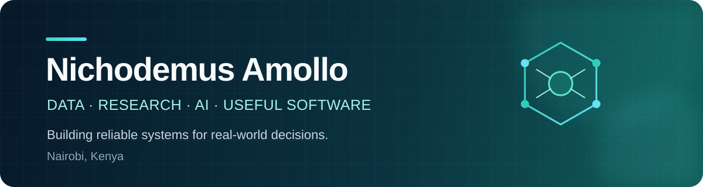

  

  <a href="https://gondamol.github.io">Portfolio</a> ·
  <a href="https://www.linkedin.com/in/nichodemusamollo/">LinkedIn</a> ·
  <a href="mailto:nichodemuswerre@gmail.com">Email</a>

I build data systems and digital products for research, health, and community organisations in Africa. My work spans the full path from messy field data to reliable pipelines, clear analysis, and software people can use.

Based in Nairobi, I work mainly with **R, Python, SQL, TypeScript, and Quarto**. I care about reproducibility, local context, and the unglamorous details that make a system trustworthy.

### What I'm working on

- Research data infrastructure and analytics workflows for large, field-based studies
- Practical AI systems for evidence synthesis, quality assurance, and decision support
- Kenya-first products for health, small businesses, agriculture, and civic participation
- Open, reproducible analysis that turns data into decisions

### Selected work

| Project | What it does | Built with |
|---|---|---|
| [**GPAK Girls**](https://github.com/gondamol/gpakgirls) · [Live site](https://www.gpakgirls.org) | Digital home for a Kenyan NGO supporting teen mothers and girls affected by sexual abuse | Next.js, TypeScript, Tailwind CSS |
| [**Olympic Data Lab**](https://github.com/gondamol/datacamp) · [Live dashboard](https://gondamol.github.io/datacamp/) | Explores 120 years of Olympic results through three analyses and a judo medal-probability model | R, Quarto, logistic regression |
| [**ChamaFlow**](https://github.com/gondamol/chamaflow) · [Live app](https://chamaflow-eight.vercel.app) | Digital records, contributions, payouts, and PDF statements for Kenyan chamas | TypeScript, web app |
| [**HustleDesk**](https://github.com/gondamol/hustledesk) · [Live app](https://hustledesk-khaki.vercel.app) | Kenya-first quotes and invoices for small businesses, including M-Pesa-ready billing | TypeScript, web app |
| [**Kenya DHS Studies**](https://github.com/gondamol/Kenya_DHS_Studies) | Reproducible analysis of Kenya's Demographic and Health Survey data | R, survey analysis |
| [**Book Sentiment Intelligence**](https://github.com/gondamol/book-sentiment-analysis) | Compares sentiment across 700+ reviews in mind, wealth, health, and skills categories | Python, VADER, NLP |

### Tools I reach for

  
  
  
  
  
  
  
  

### GitHub at a glance

  
  

### Beyond the code

Good analysis starts before the first line of code. I bring field research, data governance, training, and stakeholder communication into the same workflow as engineering and statistics. That means the output is not only technically sound—it fits the people and decisions it was built for.

If you're working on research infrastructure, public-interest technology, or an ambitious data problem in Africa, [let's talk](mailto:nichodemuswerre@gmail.com).

